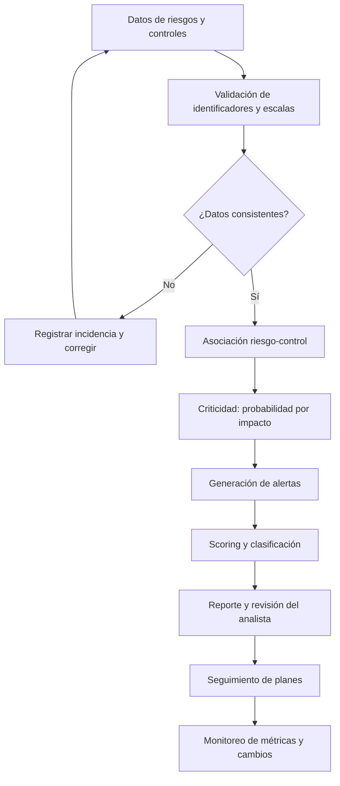

# Flujo funcional

La rama de rechazo y el seguimiento representan el flujo objetivo propuesto; el MVP actual ejecuta validaciones y priorización, pero no implementa una plataforma de gestión de incidencias.
